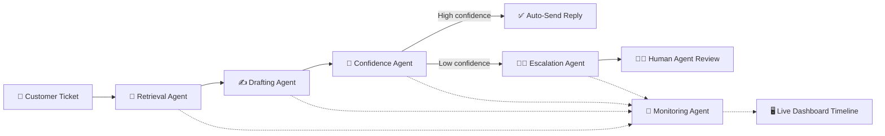

<div align="center">

<table>
<tr>
<td width="240" align="center">

</td>
<td>
<h1>ResolveFlow_AI</h1>
<h3>Autonomous Customer Support Platform</h3>
<p><b>Retrieve • Draft • Score • Escalate • Resolve</b></p>
<p>An enterprise-grade support platform powered by a 5-agent orchestration chain, real-time WebSocket telemetry, semantic vector RAG, Groq LLM inference, and an omnichannel integrations hub.</p>
</td>
</tr>
</table>

<br>

[](https://ai-customer-support-1-nfmw.onrender.com/)
[](https://nextjs.org/)
[](https://nodejs.org/)
[](https://www.mongodb.com/)
[](https://socket.io/)
[](https://groq.com/)
[](https://render.com/)

<br>

**[🚀 Live Demo](https://ai-customer-support-1-nfmw.onrender.com/)** · **[📂 View Source](https://github.com/YAKSHITH684/AI-Customer-Support)** · **[🐞 Report a Bug](https://github.com/YAKSHITH684/AI-Customer-Support/issues)**

</div>

---

## 📑 Table of Contents

- [Live Demo](#-live-demo)
- [Overview](#-overview)
- [Features](#-features)
- [How It Works](#-how-it-works)
- [The 5-Agent Chain](#-the-5-agent-chain)
- [Tech Stack](#️-tech-stack)
- [Project Structure](#️-project-structure)
- [Getting Started](#️-getting-started)
- [Environment Variables](#-environment-variables)
- [Deployment on Render](#️-deployment-on-render)
- [Demo Accounts](#-demo-accounts)
- [Roadmap](#-roadmap)
- [Contributing](#-contributing)
- [License](#-license)
- [Author](#-author)

---

## 🌐 Live Demo

🚀 **Live Application:** [ai-customer-support-1-nfmw.onrender.com](https://ai-customer-support-1-nfmw.onrender.com/)

📂 **GitHub Repository:** [github.com/YAKSHITH684/AI-Customer-Support](https://github.com/YAKSHITH684/AI-Customer-Support)

🔐 Log in with one of the [demo accounts](#-demo-accounts) to explore each role.

---

## 📌 Overview

Support teams are buried in repetitive tickets, and generic chatbots answer without knowing the company's own policies. **ResolveFlow_AI** lets customers submit tickets in plain language and gets an answer **grounded in your own knowledge base**, with a human agent stepping in whenever the AI isn't confident enough.

Every ticket runs through a chain of cooperating AI agents. High-confidence drafts are sent automatically, low-confidence ones are escalated to a human, and every step streams live to the agent dashboard so the reasoning stays inspectable.

---

## ✨ Features

| Feature | Description |
|---|---|
| 🧠 **5-Agent Orchestration** | Retrieval, drafting, confidence, escalation, and monitoring agents work as one chain |
| 📚 **Semantic Vector RAG** | Answers are grounded in your uploaded support documents, not guesses |
| ⚡ **Real-Time Telemetry** | WebSocket (Socket.IO) events stream each agent step to the dashboard live |
| 🚀 **Groq LLM Inference** | Fast response drafting powered by Groq |
| 🔀 **Smart Escalation** | Low-confidence answers are routed to human agents automatically |
| 🔌 **Omnichannel Integrations Hub** | Connect external channels and tools from one place |
| 🎫 **Ticket Management** | Customer ticket threads, agent queue, and role-based access (admin, agent, customer) |
| 🔐 **Secure by Design** | JWT authentication and encrypted stored credentials |
| 🗄️ **Zero-Config Database** | Starts an in-memory MongoDB automatically if `MONGODB_URI` is blank |

---

## 🚀 How It Works



---

## 🧠 The 5-Agent Chain

| Agent | Role |
|---|---|
| 🔎 **Retrieval** | Searches the knowledge base for the most relevant document chunks |
| ✍️ **Drafting** | Writes a reply grounded in the retrieved context |
| 📏 **Confidence** | Scores the draft and decides whether to send it or escalate |
| 🔀 **Escalation** | Routes uncertain tickets to the right human agent queue |
| 📡 **Monitoring** | Emits an event for every step, powering the live timeline and audit trail |

---

## 🛠️ Tech Stack

| Layer | Technologies |
|---|---|
| **Frontend** | Next.js, React, Tailwind CSS |
| **Backend** | Node.js, Express |
| **Database** | MongoDB (in-memory fallback for local development) |
| **Real-Time** | Socket.IO (WebSockets) |
| **AI** | Groq LLM inference, semantic vector RAG |
| **Auth & Security** | JWT, encrypted credentials |
| **Hosting** | Render |

---

## 🗂️ Project Structure

The backend and frontend are fully decoupled:

```
AI-Customer-Support/
│
├── server/                  # Standalone backend (port 5000)
│   ├── src/                 # Agents, controllers, models, routes, services
│   ├── .env.example         # Backend environment template
│   └── package.json
│
├── client/                  # Standalone frontend (port 3000)
│   ├── src/                 # Next.js pages, components, stores, styles
│   ├── .env.example         # Frontend environment template
│   └── package.json
│
├── render.yaml              # Render Blueprint for one-click cloud deploy
├── start-backend.bat        # Windows launcher for the backend
├── start-backend.ps1        # PowerShell launcher for the backend
├── start-frontend.bat       # Windows launcher for the frontend
├── start-frontend.ps1       # PowerShell launcher for the frontend
├── spec.md                  # Full technical specification
├── package.json             # Root convenience scripts
└── README.md
```

---

## ⚙️ Getting Started

### Prerequisites

- Node.js (LTS recommended)
- npm
- A free [Groq API key](https://console.groq.com/)

### 1. Clone the repository

```bash
git clone https://github.com/YAKSHITH684/AI-Customer-Support.git
cd AI-Customer-Support
```

### 2. Start the backend (Terminal 1)

```bash
cd server
npm install        # first time only
npm run dev
```

API server runs at `http://localhost:5000`. If `MONGODB_URI` is blank, an in-memory MongoDB starts automatically, so no database setup is needed.

### 3. Start the frontend (Terminal 2)

```bash
cd client
npm install        # first time only
npm run dev
```

Web app runs at `http://localhost:3000`.

### Other ways to run

| Method | How |
|---|---|
| 🪟 **Windows launchers** | Double-click `start-backend.bat` and `start-frontend.bat` (or run the `.ps1` versions) |
| ⚡ **From the root** | Run `npm run dev` to start everything together |

---

## 🔑 Environment Variables

Copy `.env.example` to `.env` in both `server/` and `client/`.

**Backend (`server/`)**

| Variable | Purpose |
|---|---|
| `NODE_ENV` | Runtime environment (`production` when deployed) |
| `CLIENT_URL` | Frontend URL allowed to call the API |
| `JWT_SECRET` | Secret used to sign login tokens |
| `CREDENTIAL_ENCRYPTION_KEY` | 32-character key for encrypting stored credentials |
| `GROQ_API_KEY` | Your Groq API key |
| `GROQ_MODEL` | Model used for inference (e.g. `openai/gpt-oss-120b`) |
| `MONGODB_URI` | MongoDB connection string (optional locally) |

**Frontend (`client/`)**

| Variable | Purpose |
|---|---|
| `NEXT_PUBLIC_API_URL` | Backend API URL, e.g. `https://your-backend.onrender.com/api` |
| `NEXT_PUBLIC_SOCKET_URL` | Backend URL for WebSocket connections |

> ⚠️ Never commit real `.env` files or API keys.

---

## ☁️ Deployment on Render

**Live URL:** [ai-customer-support-1-nfmw.onrender.com](https://ai-customer-support-1-nfmw.onrender.com/)

### Option A: Blueprint (one click)

1. Push the repository to GitHub.
2. In the [Render Dashboard](https://dashboard.render.com/), choose **New → Blueprint**.
3. Connect the repo. Render detects `render.yaml` and creates both services.
4. Add `GROQ_API_KEY` and, optionally, `MONGODB_URI` in the dashboard.

### Option B: Two manual Web Services

| Setting | Backend | Frontend |
|---|---|---|
| **Root Directory** | `server` | `client` |
| **Environment** | Node | Node |
| **Build Command** | `npm install` | `npm install && npm run build` |
| **Start Command** | `npm start` | `npm start` |

Set the environment variables listed above on each service, using your deployed backend URL for `NEXT_PUBLIC_API_URL` and `NEXT_PUBLIC_SOCKET_URL`, and your deployed frontend URL for `CLIENT_URL`.

---

## 🔐 Demo Accounts

Use these to explore each role:

| Role | Email | Password |
|---|---|---|
| **Support Agent** | `agent@resolveflow.ai` | `Password123!` |
| **Administrator** | `admin@resolveflow.ai` | `Password123!` |
| **Customer** | `customer@acme.com` | `Password123!` |

> These are demo credentials only. Change or remove them before using the app with real data.

---

## 🔮 Roadmap

- [ ] 📊 Analytics and CSAT reporting
- [ ] 🌍 Multi-language support
- [ ] 🎙️ Voice support channel
- [ ] 🧪 Automated evaluation of AI answer quality
- [ ] 📱 Mobile-friendly agent app
- [ ] 🏢 Multi-tenant workspaces

---

## 🤝 Contributing

Contributions are welcome!

1. Fork the repository
2. Create a feature branch: `git checkout -b feature/your-feature`
3. Commit your changes: `git commit -m "Add your feature"`
4. Push to your branch: `git push origin feature/your-feature`
5. Open a Pull Request

---

## 📄 License

No license has been added yet. Add one (e.g. MIT) if you want others to reuse this project.

---

## 👨‍💻 Author

**YAKSHITH684**
GitHub: [@YAKSHITH684](https://github.com/YAKSHITH684)

<div align="center">

Built with Next.js, Node.js, MongoDB, Socket.IO, Groq, and Render.

⭐ If you find this project useful, consider giving the repository a star!

</div>
